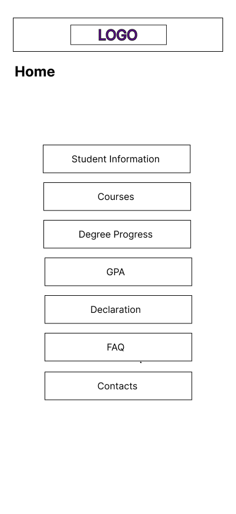
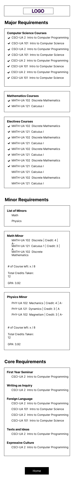
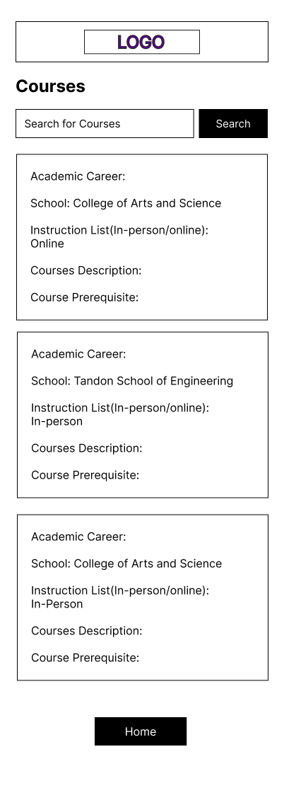
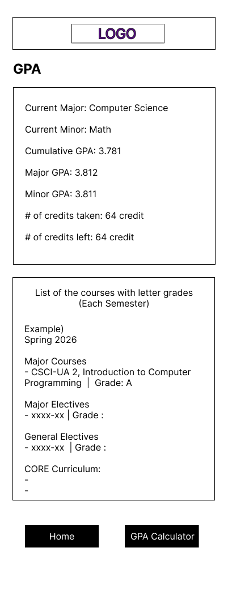
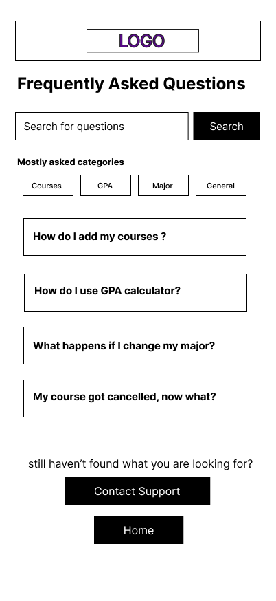
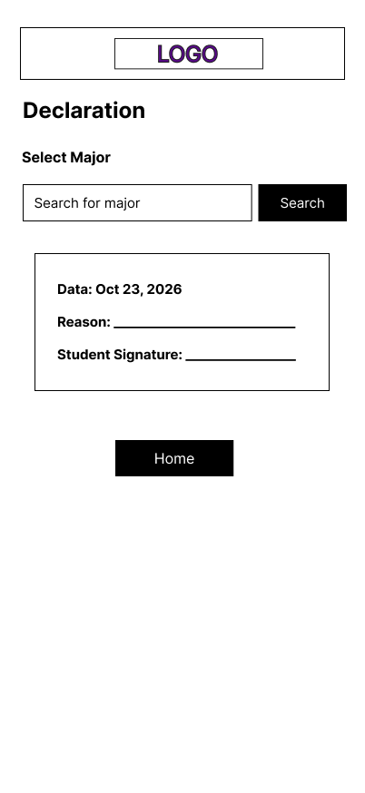

# User Experience Design

## App Map

## Wireframes(Mobile)
| Log In | Sign Up | Home | Student Information |
|:---:|:---:|:---:|:---:|
|  |  |  |  |

| Degree Progess | Requirements | Graduation Check |
|:---:|:---:|:---:|
|  |  |  |

| Courses | GPA | Target GPA Calculator |
|:---:|:---:|:---:|
|  |  |  |

| FAQ | Password Reset | Declaration | Department Contacts |
|:---:|:---:|:---:|:---:|
|  |  |  |  |

## Prototype
[Link to Prototype](https://www.figma.com/proto/I5n9GRpWSGLroOm7SXeAVS/Violet-Path-Design?node-id=1-3&p=f&t=JGg0aCRSMtDFZib9-1&scaling=scale-down&content-scaling=fixed&page-id=0%3A1&starting-point-node-id=1%3A3)